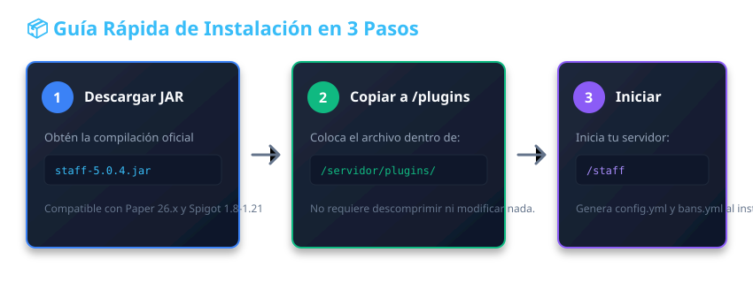

# Instalación



Instalar **StaffPlus** en tu servidor es un proceso directo que solo requiere copiar el archivo compilado en el directorio de plugins.

---

## 📥 Pasos de Instalación

1. **Descargar el archivo:**
   Obtén la compilación más reciente `staff-5.0.4.jar`.
2. **Copiar al servidor:**
   Coloca el archivo JAR dentro de la carpeta `plugins/` de tu servidor de Minecraft.
3. **Reiniciar el servidor:**
   Inicia o reinicia el servidor. Durante el arranque verás un mensaje similar a:
   ```text
   [INFO]: [StaffPlus] Loading server plugin StaffPlus v5.0.4
   [INFO]: [StaffPlus] Detected server version 'v26_3_R1' from Bukkit version string.
   [INFO]: [StaffPlus] Version protocol set to 'v26_3_R1'.
   [INFO]: [StaffPlus] Enabling StaffPlus v5.0.4
   ```
4. **Verificar la carga:**
   Ejecuta en la consola:
   ```bash
   pl
   ```
   Asegúrate de que **StaffPlus** aparezca en color verde en la lista de plugins.

---

## 🔌 Plugins Opcionales Recomendados

* **[LuckPerms](https://luckperms.net/):** Para gestionar los permisos de los diferentes rangos (Helper, Mod, Admin).
* **[PlaceholderAPI](https://placeholderapi.com/):** Para mostrar variables de StaffPlus en scoreboards o tablists.
* **[ViaVersion / ViaBackwards](https://viaversion.com/):** Para permitir la conexión de clientes en versiones anteriores o posteriores.

---

## ⚠️ Solución de Problemas Frecuentes

### Desconexión inmediata al entrar (`lost connection: Disconnected`)
Si al intentar entrar al servidor con una cuenta no-premium la consola muestra:
```text
[INFO]: Usuario (/192.168.1.1:12345) lost connection: Disconnected
```
* **Causa:** El servidor tiene configurado `online-mode=true` en `server.properties`.
* **Solución:** Abre `server.properties`, cambia `online-mode=true` a `online-mode=false` y reinicia el servidor.

