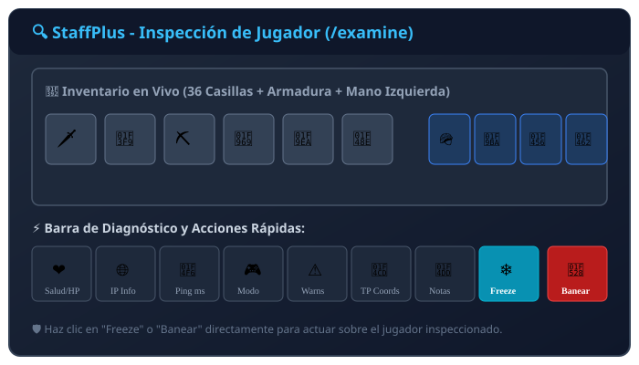
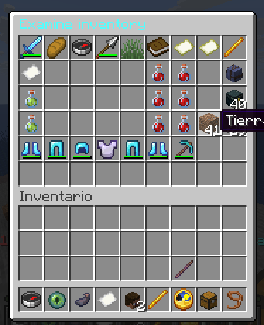

# Inspección de Inventario (/examine)



El comando `/examine` abre una interfaz en tiempo real que replica exactamente lo que el jugador objetivo tiene en su poder, permitiendo auditar posibles objetos ilegales o duplicados.

---

## 🔍 Uso del Comando

```bash
/examine <jugador>
```
*(Permiso requerido: `staff.examine`)*
*También se puede activar usando el gadget del **Cofre** (Slot 8 de la hotbar de staff) haciendo clic derecho sobre el jugador.*

---

## 🖥️ Estructura de la Interfaz



La pantalla de examen se divide en dos secciones principales:

### 1. Inventario del Jugador (Slots 0 al 44)
* **Objetos del inventario y barra rápida:** Muestra los ítems con sus encantamientos, lore y cantidades exactas.
* **Armadura:** Casco, pechera, pantalones y botas en tiempo real.
* **Mano Secundaria (Offhand):** En versiones 1.9+ y Paper 26.x, muestra el objeto equipado en la mano izquierda.

### 2. Barra de Información y Acciones Tácticas (Última fila)
La fila inferior ofrece accesos directos de diagnóstico y sanción:

| Icono | Elemento | Información / Acción |
| :---: | :--- | :--- |
| 🍎 | **Comida y Salud** | Muestra los puntos de vida actuales y nivel de saturación. |
| 🌐 | **Dirección IP** | Muestra la IP pública de conexión (oculta si el staff no tiene `staff.staffplus.hideip`). |
| 📶 | **Ping y Latencia** | Muestra el tiempo de respuesta en milisegundos con el servidor. |
| 🎮 | **Modo de Juego** | Indica si el jugador está en Supervivencia, Aventura, Creativo o Espectador. |
| ⚠️ | **Infracciones** | Recuento de advertencias acumuladas por el usuario. |
| 📍 | **Ubicación** | Coordenadas exactas (X, Y, Z, Mundo). Al hacer clic, te teletransporta a su posición. |
| 📝 | **Notas** | Abre el panel de notas secretas asociadas al jugador. |
| ❄️ | **Congelar** | Botón para congelar al jugador al instante sin salir de la interfaz. |
| 🔨 | **Sancionar (Ban)** | Abre directamente el panel de `/bangui` con los datos del usuario cargados. |

---

## ✍️ Modificación de Inventarios
Si el moderador cuenta con el permiso `staff.examine.modify` (o es Operador):
* Puede retirar objetos sospechosos directamente arrastrándolos fuera de la interfaz para confiscarlos.
* Si no dispone de este permiso, la interfaz es de **solo lectura**, impidiendo alteraciones accidentales.

