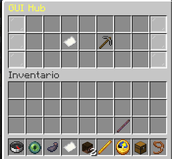

# Reportes y Tickets de Soporte

StaffPlus incluye dos canales directos para que los jugadores puedan comunicarse con el equipo de moderación: **Reportes de Infracciones** y **Tickets de Asistencia**.

---

## 🚨 Módulo de Reportes (/report)

Permite a los usuarios denunciar a otros jugadores por faltas a las normas (hacks, insultos, grifeo, etc.).

### Comandos
* **Enviar una denuncia:**
  ```bash
  /report <jugador> <motivo>
  ```
  *(No requiere permisos especiales para jugadores comunes)*.

### Notificación y Almacenamiento
* Cuando un usuario envía un reporte, todos los miembros del staff con el permiso `staff.report` reciben un sonido de alerta y un mensaje en el chat con el nombre del denunciante, el acusado y el motivo.
* Los reportes se almacenan en el sistema hasta que un moderador los marque como resueltos.
* **Cooldown anti-spam:** Por defecto, los usuarios deben esperar 10 segundos entre cada reporte (configurable en `cooldown`).

### Gestión en el GUI Hub
En el menú del objeto **Papel** del Modo Staff:
* Accede a la opción **Reportes sin resolver**.
* Haz clic sobre un reporte para teletransportarte directamente a la posición del jugador denunciado o eliminar el reporte una vez atendido.



---

## 🎫 Módulo de Tickets (/ticket)

Pensado para dudas generales, solicitudes de soporte técnico o problemas de jugabilidad que no involucran a otro usuario directamente.

### Comandos
* **Crear un ticket de ayuda:**
  ```bash
  /ticket <mensaje de ayuda>
  ```
* **Responder o gestionar tickets (Staff):**
  *(Requiere el permiso `staff.tickets`)*.

### Opciones en `config.yml`
```yaml
tickets-module:
  enabled: true
  # Si las respuestas adicionales de los tickets se envían a todo el staff
  global: false
  # Si varios miembros del staff pueden responder a un mismo ticket
  keep-open: false
```

