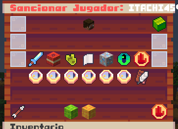

# Sistema de Bans e IP Bans

StaffPlus cuenta con un sistema nativo y robusto de sanciones que permite vetar el acceso a jugadores problemáticos tanto por su **nombre de usuario/UUID** como por su **dirección IP**, de forma permanente o temporal.

---

## 📜 Comandos Disponibles

### 1. Sanciones a Jugadores
* **Ban Permanente:**
  ```bash
  /ban <jugador> [razón] [-s]
  ```
* **Ban Temporal:**
  ```bash
  /tempban <jugador> <duración> [razón] [-s]
  ```
  *Formatos de duración soportados:* `30m` (minutos), `2h` (horas), `7d` (días), `1mo` (meses), `1y` (años).
  *El modificador opcional `-s` ejecuta la sanción de forma silenciosa sin alertar a todo el servidor.*

* **Desbanear Jugador:**
  ```bash
  /unban <jugador>
  ```

---

### 2. Sanciones por Dirección IP
* **Ban de IP Permanente:**
  ```bash
  /banip <jugador|IP> [razón] [-s]
  ```
* **Ban de IP Temporal:**
  ```bash
  /tempbanip <jugador|IP> <duración> [razón] [-s]
  ```
* **Desbanear IP:**
  ```bash
  /unbanip <jugador|IP>
  ```

---

### 3. Consultar Información de Sanción
* **Ver detalles de un ban activo:**
  ```bash
  /baninfo <jugador|IP>
  ```
  Muestra el motivo, quién aplicó la sanción, la fecha de expiración y si existe una sanción por IP asociada.

---

## 🛡️ Detección Histórica de IPs (Anti-Multicuentas)

El plugin registra automáticamente la última dirección IP de cada jugador en [bans.yml](file:///c:/Users/Usuario/Documents/GitHub/staff-pluss/StaffPlusCore/src/main/resources/bans.yml) en las secciones:
* `ips.history`: Mapeo de UUID a dirección IP.
* `ips.names`: Mapeo de nombres de usuario a UUID.

Gracias a esto, si un usuario que ha cometido una falta se desconecta, puedes ejecutar `/banip <nombre>` y el sistema localizará automáticamente su IP registrada para aplicarle la sanción de inmediato.

---

## 🎨 Pantalla de Sanción al Conectar



Cuando un usuario sancionado intenta ingresar, recibe una pantalla formateada y clara:

```text
-----------------------------------------------------
HAS SIDO SANCIONADO DE ESTE SERVIDOR

Razón: Uso de clientes no permitidos (KillAura)
Sancionado por: Admin_Alex
Duración: 6 días, 23 horas y 59 minutos
Expira el: 08/11/2026 14:30:00
(Sanción de IP activa)

-----------------------------------------------------
```

